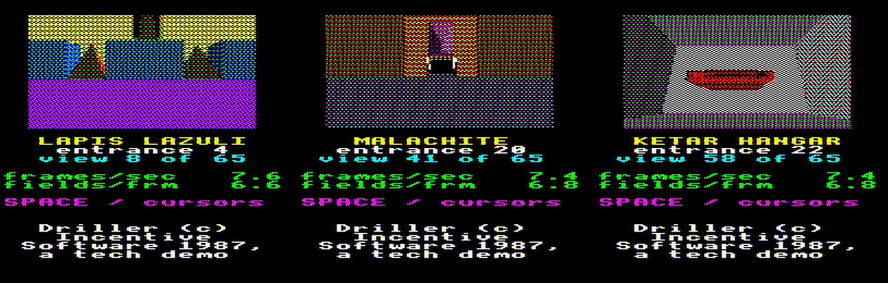

# Freescape on the BBC Master

A Freescape engine for the BBC Master 128, in MODE 2's many colours and as
fast as the machine allows. Freescape is Incentive Software's solid-3D
engine of *Driller* (1987), *Dark Side*, *Total Eclipse* and *Castle
Master*. It never came out for the BBC. This engine is proved on
*Driller*: its data, its camera and its views are the benchmark.

**[Run the disc in jsbeeb](https://bbc.xania.org/?autoboot&model=Master&displayMode=pal&disc1=github:mattgodbolt/freescape-beeb/freescape.ssd)**
(a Master 128 on a PAL television, whose blur blends the dithers as a real
one does; jsbeeb's settings switch it to an RGB monitor), or write
`freescape.ssd` to a disc and SHIFT-BREAK a Master. The disc follows the
work as it lands, so it's in progress.


*A preview: Beryl, one of Driller's areas, as the engine's Python model renders it
in MODE 2, the ST's colours dithered from the BBC's eight, seen through
jsbeeb's PAL television. The 6502 is being built to draw exactly this.*

## Where it's up to

*2026-10-31.* **The disc draws Driller's views on the BBC itself.** It's a
slideshow of all 65 of Driller's entrance views: each view's faces are
worked out ahead of time by the Python model, and the Master's own
rasteriser and row writer draw them into MODE 2 every frame,
double-buffered, flipping as soon as the beam leaves the view. Every frame
it draws matches the model byte for byte. SPACE or the cursor keys step
between views, and the screen shows the frame rate as it's measured.



*The disc in jsbeeb through PAL: the Master drawing three of Driller's
entrance views itself. Driller is Incentive Software's.*

It's correct and not yet fast: a frame takes a median of about three
fields. The rest of the renderer (the object pass, the transform, the
projection and the clips) is built in 6502 and matches the model exactly
too, and every stage is now being made fast. Driller's own ZX code runs
headless as the oracle, and Driller's player logic is transcribed and
checked pass by pass against it, with its 6502 version under way.
`docs/journal.md` has the story as it goes.


*Nine of Driller's 65 entrance views from the model, through PAL: the
MODE 2 dithers blend on a television as they would on a real one. Driller
is Incentive Software's.*


*Two of Driller's entrance views. Left: Driller's own ZX code drawing
them, run headless. Middle: the Python model's render, which the 6502 is
being built to match, in the ST's colours as MODE 2 dithers on an RGB
monitor. Right: the same through jsbeeb's PAL television. Driller is
Incentive Software's.*

## How it works

The design is in [`docs/engine.md`](docs/engine.md). In short:

- **MODE 2**, eight colours with ordered dithers between them, in a
  128-pixel-wide screen double-buffered in main and shadow RAM at one
  address. The view is Driller's ZX view at half the width.
- **The transform is exact, so it's cached.** Camera-space vertices keep
  every bit, so a step that only moves the camera costs a subtraction a
  coordinate and no multiplies. Freescape's geometry (boxes on a byte
  grid, angles in 5° steps) is unusually cheap to start with.
- **The original's draw order, taken front to back** into a span buffer.
  That gives exactly the painter's image the original draws, but writes
  every screen byte once, with no clear and no copy.
- **Rows written by unrolled code**, as in Eben Upton's Solid Elite, with
  a byte where two faces meet built from both patterns, never read back
  from the screen.

## How it's being made

The way the [Chuckie Egg 2](https://github.com/mattgodbolt/chuckie-egg-2-beeb),
[Ninja Massacre](https://github.com/mattgodbolt/nm) and
[Starglider](https://github.com/mattgodbolt/starglider-beeb) ports were
made: the original is the specification, its own code runs headless as
an oracle, and every stage is checked in a headless
[jsbeeb](https://github.com/mattgodbolt/jsbeeb).

- The specification is Driller's ZX Spectrum version (decision 1): its
  geometry, camera and view. The colours come from the colour versions.
- A Python model of the renderer (`tools/model/`) uses the 6502's own
  integer arithmetic. Every 6502 stage must match it byte for byte, and
  the model is checked against the original.
- `docs/decisions.md` has every call the engine makes that the original
  didn't. `BRIEF.md` is where it started: Freescape's versions, the BBC's
  best solid 3D, and the options with their figures.

## Building

You need [baron](https://github.com/waitingforvsync/baron) 0.6.0 (at
`../baron/build/src/baron`, on the PATH, or named in `local.mk`), Node.js,
Python 3 and [uv](https://github.com/astral-sh/uv). The build reads
Driller from the originals `make fetch` downloads; nothing of Driller's
is committed.

```sh
npm ci          # the jsbeeb harness
make venv       # .venv: SkoolKit, Pillow, NumPy, py65
make fetch      # the originals, into originals/
make            # everything the tracks build so far
make check      # every check
```

## Where things are

| Path | What |
|---|---|
| `src/` | the engine, in 6502 assembly |
| `tools/` | the model, the build's generators, and the jsbeeb harness |
| `docs/` | the design, the journal, the decisions, the research |
| `mk/` | each part's Makefile rules |
| `originals/` | where `make fetch` puts the originals (never committed) |

## Rights

*Driller* is Incentive Software's. The disc is a tech demo of the engine,
shown on Driller's scenes with that attribution on the disc; it isn't a
release of the game. Nothing else of Driller's is committed: the build
reads it from copies `make fetch` downloads.

## Credits

- **Incentive Software**: Freescape and *Driller*, designed by Chris
  Andrew and programmed by Chris Andrew (Spectrum, CPC) and Stephen
  Northcott (C64).
- **ScummVM**'s Freescape engine, which reads every version's data, and
  **Santiago Ontañón**'s annotated disassembly of *Castle Master II*,
  which maps the 8-bit pipeline.
- The engine's methods stand on **Rich Talbot-Watkins**'s portal engine
  and [baron](https://github.com/waitingforvsync/baron), **Eben Upton**'s
  Solid Elite, lander and DOOM, and **Kieran Connell**'s
  [beeb-port-kit](https://github.com/kieranhj/beeb-port-kit) and BEEB-NICCC.
