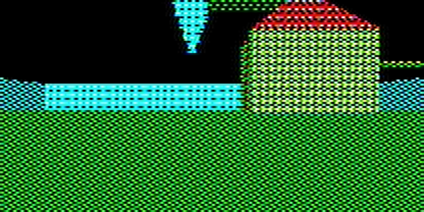
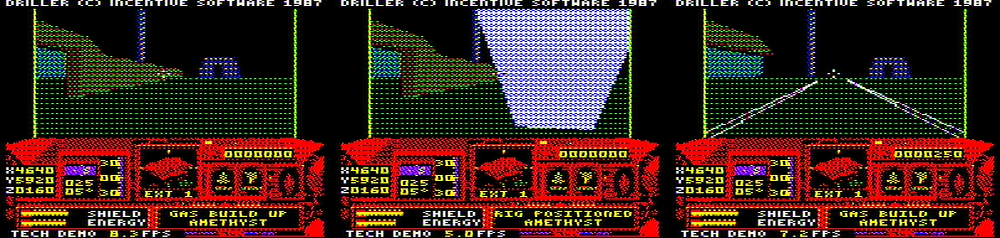
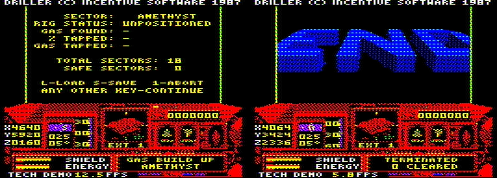
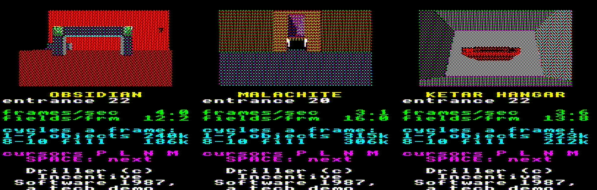
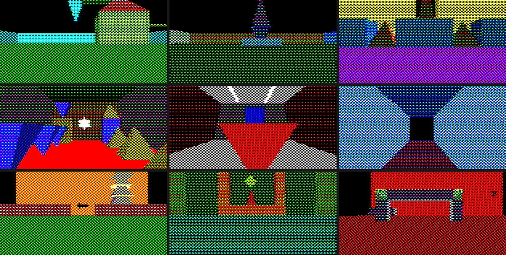
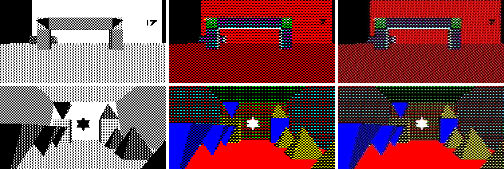

# Freescape on the BBC Master

A Freescape engine for the BBC Master 128, in MODE 2's many colours and as
fast as the machine allows. Freescape is Incentive Software's solid-3D
engine of *Driller* (1987), *Dark Side*, *Total Eclipse* and *Castle
Master*. It never came out for the BBC. This engine is proved on
*Driller*: its data, its camera and its views are the benchmark.

**[Run the disc in jsbeeb](https://bbc.xania.org/?autoboot&model=Master&displayMode=pal&disc1=github:mattgodbolt/freescape-beeb/freescape.ssd)**
(a Master 128 on a PAL television, whose blur blends the dithers as a real
one does; jsbeeb's settings switch it to an RGB monitor), or write
`freescape.ssd` to a disc and SHIFT-BREAK a Master. The disc follows the
work as it lands, so it's in progress.



*Beryl, one of Driller's areas, as the engine's Python model renders it
in MODE 2, the ST's colours dithered from the BBC's eight, seen through
jsbeeb's PAL television. The 6502 draws exactly this. Driller is Incentive
Software's.*

## Where it's up to

**All of Driller's game is on the disc, as one game**: walking, sound,
the drilling rigs, the laser, the guard sensors, the clock, the end and a
new game, the information screen, and Driller's own demo. Not in: the
title screen (the tape's loading screen, which the disc doesn't have), the
panel's rig animation (the Atari ST version's only; the Spectrum's, which
is the specification, has none) and save and load (the Spectrum's go to tape;
decision 153). The sections below are how each layer landed, dated.



*The disc in jsbeeb through PAL television (the blur blends the dithers), left
to right: Driller's start with the panel; a drilling rig set down (D),
its message RIG POSITIONED; the laser firing (0), its four beams from the
view's bottom corners to the crosshair, a hit scoring. Driller is Incentive
Software's.*



*Left: Driller's information screen (I), in the original's words. Right:
the end's scene, area 127's 3D END, after the game is abandoned (1 on the
information screen), with its panel message TERMINATED. Any key starts a
new game. Driller is Incentive Software's.*

*2026-10-31.* **You can walk Driller on the BBC, with Driller's own
logic, and every frame worked out live.** The disc starts at Driller's
start, in Amethyst. **Z and X turn, : and / walk** (or the cursor keys,
or Driller's own Q, W, O and K); P and L look up and down, N and M roll,
R and F rise and fall, U turns round, f0 and f1 set the turn's size and f2
and f3 the step's, B shows the crosshair, SPACE is shooting mode (the
walking keys move the crosshair), 0 or COPY fires, D sets a rig down, C
collects it, I is the information screen (and ESCAPE or 1 abandons the
game from it), and RETURN starts a new game after the end. You collide, climb, fall and go through
doorways into other areas as in the original, because it is the
original's logic, transcribed into 6502 and checked pass by pass against
the original running headless. A tap turns 5° or steps 25 units, one
of Driller's own moves; holding a key repeats it smoothly, like a
keyboard's auto-repeat, and f0-f3 change the sizes.

*2026-11-06.* **Driller's sounds**, remade for the BBC's sound chip from
the Spectrum original's own beeper, measured a fiftieth of a second at a
time: the low bump of a wall (and of SPACE, into shooting mode), the two
notes of a climb and of a fall, the chirp of a doorway, and the scripts'
sounds as things are touched and the clock turns. They play from the interrupt while
the game goes on, so they cost the frames nothing (the original stops
while each plays). Driller has no key for the sound, so neither has the
disc.

*2026-11-08.* **Driller's drilling rigs.** D sets a rig down in front of
the probe, if it fits there, and C picks it up again, as in the original,
whose code for them is transcribed and checked against it. The rig stands
in the view, solid (you can walk into its legs), and the panel's message
line says what happened: PROCESSING, RIG POSITIONED, how much gas it
found and what share of it, or why not (no room, the jet, too little
energy, a neutral area, a rig there already). Near an area's gas a rig
finds more and scores more; half or more makes the sector safe, and
eighteen safe sectors win the game.

*2026-11-08.* **The laser and the guard sensors.** 0 fires: the
original's four beams from the view's bottom corners to the crosshair,
for as long as its sound plays, and whatever is under the crosshair is
hit, so its own script runs: a pyramid vanishes, a cuboid scores, a
sensor can be shot out. The guard sensors watch: one in range with a
clear line to the probe fires at it every so often, its four beams
flashing down the view if it's on the screen, a crack of sound, and a
unit of shield gone; with none left the game ends. Both are the
original's code transcribed and checked against it, the picks made from
the BBC's own frame.

*2026-11-08.* **The end of the game, a new game, and the demo.** A fall
too far, the shield or the energy run out, or the eighteenth safe sector
ends the game as the original does: the panel says why, the end's own
scene comes up with the safe sectors in its name, and after a moment any
key (RETURN will do) starts a new game. Leave it alone and Driller's own
demo plays itself, the original's recorded moves, drilling and shooting
included, until a key starts a game. The original's four-hour clock
counts down too, a second at a time, spending a unit of energy each
minute; let it run out and the game ends OUT OF TIME.

*2026-11-08.* **The information screen.** I shows Driller's own: the
sector, its rig, the gas found and tapped, and the safe sectors, in the
view, in the original's words; any key goes back to the game, and 1
abandons it. (Its S and L save and load to the Spectrum's tape, which the
BBC hasn't; on the disc they go back to the game.)

Every frame, the Master works out the view from the camera alone (the
visible objects, the rotation, the projection, the clipping and the
order) and fills it into MODE 2, double-buffered, flipping as soon as the
beam leaves the view. Every frame the disc's check sees matches the
Python model's render of the same camera, byte for byte.



*The disc in jsbeeb through PAL: Driller's start, a step, and the jet.
The panel is Driller's own, the Atari ST version's console cut down to
MODE 2's 128 pixels, with its score, shield and energy, heading and pitch,
step and turn, position, vehicle, area and messages, driven by Driller's
logic; the frames a second beside "tech demo" are the BBC's own timing of
the whole frame. Driller is Incentive Software's.*

**How fast:** measured on the disc's check (journal, 2026-11-09), the
whole frame, flip to flip, walking through Driller's areas takes a median
of about 1.69 fields (about 30 frames a second) and turning about 2.18
(about 23), over every run the check makes, which since the end and the
demo came include their busier views (over the runs it had before them,
walking takes about 1.55 and turning 2.1); wide open views, like the
entrances, take longer, about 8.5 fields at the median. Standing still
draws nothing, so a key starts the next frame at once. The original
redrew about once every two-thirds of a second on the Spectrum. Every
stage matches the model exactly, so the work from here is speed, on a
stock Master. Driller's game itself is all in (see below);
`docs/research/game-audit.md` has what of it is ported, checked, and
what isn't, and `docs/journal.md` has the story as it goes.



*Nine of Driller's 65 entrance views from the model, through PAL: the
MODE 2 dithers blend on a television as they would on a real one. Driller
is Incentive Software's.*



*Two of Driller's entrance views. Left: Driller's own ZX code drawing
them, run headless. Middle: the Python model's render, which the 6502
matches byte for byte, in the ST's colours as MODE 2 dithers on an RGB
monitor. Right: the same through jsbeeb's PAL television. Driller is
Incentive Software's.*

## How it works

The design is in [`docs/engine.md`](docs/engine.md). In short:

- **MODE 2**, eight colours with ordered dithers between them, in a
  128-pixel-wide screen double-buffered in main and shadow RAM at one
  address. The view is Driller's ZX view at half the width.
- **The transform is exact, so it's cached.** Camera-space vertices keep
  every bit, so a step that only moves the camera costs a subtraction a
  coordinate and no multiplies. Freescape's geometry (boxes on a byte
  grid, angles in 5° steps) is unusually cheap to start with.
- **The original's draw order, taken front to back** into a span buffer.
  That gives exactly the painter's image the original draws, but writes
  every screen byte once, with no clear and no copy.
- **Rows written by unrolled code**, as in Eben Upton's Solid Elite, with
  a byte where two faces meet built from both patterns, never read back
  from the screen.

## How it's being made

The way the [Chuckie Egg 2](https://github.com/mattgodbolt/chuckie-egg-2-beeb),
[Ninja Massacre](https://github.com/mattgodbolt/nm) and
[Starglider](https://github.com/mattgodbolt/starglider-beeb) ports were
made: the original is the specification, its own code runs headless as
an oracle, and every stage is checked in a headless
[jsbeeb](https://github.com/mattgodbolt/jsbeeb).

- The specification is Driller's ZX Spectrum version (decision 1): its
  geometry, camera and view. The colours come from the colour versions.
- A Python model of the renderer (`tools/model/`) uses the 6502's own
  integer arithmetic. Every 6502 stage must match it byte for byte, and
  the model is checked against the original.
- `docs/decisions.md` has every call the engine makes that the original
  didn't. `BRIEF.md` is where it started: Freescape's versions, the BBC's
  best solid 3D, and the options with their figures.

## Building

You need [baron](https://github.com/waitingforvsync/baron) 0.6.0 (at
`../baron/build/src/baron`, on the PATH, or named in `local.mk`), Node.js,
Python 3 and [uv](https://github.com/astral-sh/uv). The build reads
Driller from the originals `make fetch` downloads; nothing of Driller's
is committed.

```sh
npm ci          # the jsbeeb harness
make venv       # .venv: SkoolKit, Pillow, NumPy, py65
make fetch      # the originals, into originals/
make            # everything the tracks build so far
make check      # every check
```

## Where things are

| Path | What |
|---|---|
| `src/` | the engine, in 6502 assembly |
| `tools/` | the model, the build's generators, and the jsbeeb harness |
| `docs/` | the design, the journal, the decisions, the research |
| `mk/` | each part's Makefile rules |
| `originals/` | where `make fetch` puts the originals (never committed) |

## Rights

*Driller* is Incentive Software's. The disc is a tech demo of the engine,
shown on Driller's scenes with that attribution on the disc; it isn't a
release of the game. Nothing else of Driller's is committed: the build
reads it from copies `make fetch` downloads.

## Credits

- **Incentive Software**: Freescape and *Driller*, designed by Chris
  Andrew and programmed by Chris Andrew (Spectrum, CPC) and Stephen
  Northcott (C64).
- **ScummVM**'s Freescape engine, which reads every version's data, and
  **Santiago Ontañón**'s annotated disassembly of *Castle Master II*,
  which maps the 8-bit pipeline.
- The engine's methods stand on **Rich Talbot-Watkins**'s portal engine
  and [baron](https://github.com/waitingforvsync/baron), **Eben Upton**'s
  Solid Elite, lander and DOOM, and **Kieran Connell**'s
  [beeb-port-kit](https://github.com/kieranhj/beeb-port-kit) and BEEB-NICCC.
